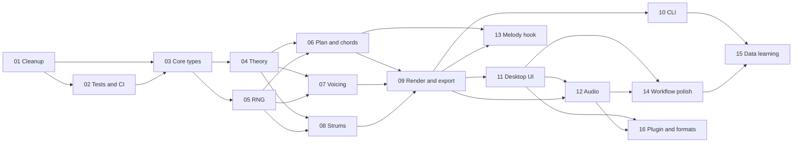

# Algo-Rythm Specs: Index

Spec set version: 1.0
Date: 2026-10-30
Source document: Algo-Rythm Coding Spec for a Guitar Song Starter App (Sections 1 to 11)

## 1. Purpose

This folder divides the Algo-Rythm work into 16 spec files.
Each spec file covers one work area.
Each spec file contains requirements and tasks.
Do the tasks in the order that the dependency table shows.
Some tasks wait for a task in a later spec. The "Prerequisites" field of each task shows this.

## 2. Spec list

| Spec | File | Milestone | Depends on |
| --- | --- | --- | --- |
| SPEC-01 | [01-repo-cleanup.md](01-repo-cleanup.md) | M0 | None |
| SPEC-02 | [02-test-and-ci.md](02-test-and-ci.md) | M0 | SPEC-01 (T01-01) |
| SPEC-03 | [03-core-types-and-data.md](03-core-types-and-data.md) | M1 | SPEC-01, SPEC-02 |
| SPEC-04 | [04-theory-functions.md](04-theory-functions.md) | M1 | SPEC-03 |
| SPEC-05 | [05-rng-and-determinism.md](05-rng-and-determinism.md) | M1 | SPEC-03 |
| SPEC-06 | [06-song-plan-and-progressions.md](06-song-plan-and-progressions.md) | M2 | SPEC-04, SPEC-05 |
| SPEC-07 | [07-voicing-engine.md](07-voicing-engine.md) | M2 | SPEC-04, SPEC-05 |
| SPEC-08 | [08-strum-engine.md](08-strum-engine.md) | M2 | SPEC-04, SPEC-05 |
| SPEC-09 | [09-render-and-export.md](09-render-and-export.md) | M2 | SPEC-06, SPEC-07, SPEC-08 |
| SPEC-10 | [10-cli.md](10-cli.md) | M2 | SPEC-09 |
| SPEC-11 | [11-desktop-app-ui.md](11-desktop-app-ui.md) | M3 | SPEC-09 |
| SPEC-12 | [12-audio-playback.md](12-audio-playback.md) | M3 | SPEC-09, SPEC-11 |
| SPEC-13 | [13-melody-hook.md](13-melody-hook.md) | M4 | SPEC-06, SPEC-09 |
| SPEC-14 | [14-workflow-polish.md](14-workflow-polish.md) | M4 | SPEC-11, SPEC-12 |
| SPEC-15 | [15-data-learning.md](15-data-learning.md) | M5 | SPEC-10, SPEC-14 |
| SPEC-16 | [16-plugin-and-formats.md](16-plugin-and-formats.md) | M6 | SPEC-11, SPEC-12 |

## 3. Dependency order

The diagram shows the order of the specs. GitHub shows it as a flowchart.



## 4. Text standard: ASD-STE100 at 80%

All requirements and tasks use ASD-STE100 Simplified Technical English (STE).
"80% format" means that the text obeys the STE rules for text.
The text can also use project technical names and some technical verbs that are not in the STE dictionary.
Examples of these technical verbs are "compile", "commit", "serialize", "parse" and "render".

Obey these rules when you add a spec or change a spec:

1. Write a procedural sentence (an instruction) with 20 words or fewer.
2. Write a descriptive sentence with 25 words or fewer.
3. Write one instruction in each step. You can write two instructions in one step only if you do them at the same time.
4. Use the imperative (command) form for instructions. Example: "Add the file." Do not write "The file should be added."
5. Use the active voice.
6. Use only the simple tenses: past, present and future.
7. Do not use the "-ing" form of a verb. You can use "-ing" words that are technical names, for example "string" or "voicing".
8. Use one word for one meaning. Use the same technical name for the same item in all specs.
9. Put a condition before its instruction. Example: "If the test fails, stop the work."
10. Use "must" for a requirement. Do not use "should" or "shall".
11. Use "make sure" for a check. Do not use "ensure".
12. Use "use" and "write" or "add". Do not use "utilize" or "implement".
13. Write a paragraph with 6 sentences or fewer.
14. Use vertical lists for 3 or more items.

## 5. Task format

Each task uses this format:

```markdown
### T<spec>-<number>: <Title in imperative form>

- **Status:** [ ] Open
- **Prerequisites:** <task IDs, or "None">
- **Files:** <files that the task adds or changes>

**Procedure:**

1. <One instruction, 20 words or fewer.>
2. <One instruction, 20 words or fewer.>

**Acceptance:**

- [ ] <One check, 25 words or fewer.>
```

Rules for tasks:

- The task ID is unique. Example: T07-03 is task 3 in SPEC-07.
- A task must take 4 hours or less. If a task takes more time, divide it into two tasks.
- A prerequisite must be a task ID in this folder.
- When you complete a task, change "[ ] Open" to "[x] Done".
- When an acceptance check passes, mark it with "[x]".

## 6. Terms

| Term | Meaning |
| --- | --- |
| core | The JUCE-free C++17 library `algo::core` |
| app | The JUCE desktop application in `app/` |
| CLI | The command-line tool `algo-cli` |
| song starter | The generator output: key, tempo, form, chords, voicings, strums and an optional hook |
| voicing | The fret and string for each note of one chord |
| stroke | One slot in a strum pattern: Down, Up, Rest, Mute or Chuck |
| seed | The 64-bit integer that controls all random choices |
| difficulty | Beginner, Intermediate or Advanced |
| PPQ | Pulses (ticks) per quarter note. The value is 480. |
